# LOSNITO Document — YPL Smart Digital Library

> Platform **Digital Knowledge, Governance & Community** Yayasan Pendidikan Lokon (YPL).
> Prinsip: **DISCOVER → KNOW → UNDERSTAND → ACT**. Dua mode utama: **Library Mode** (discovery) dan **Reader Mode** (baca imersif).

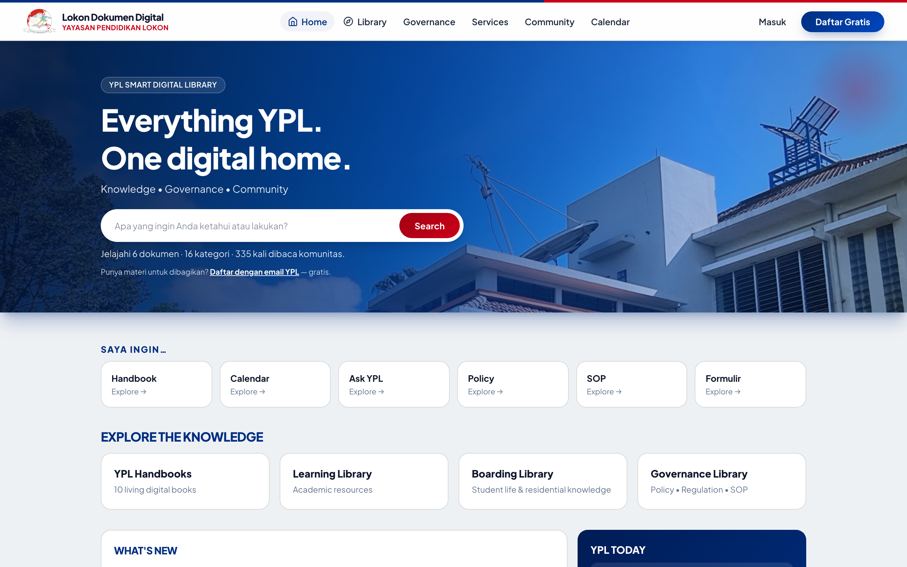

- **Status (12 Okt 2026):** 141 tests lolos (872 assertions) · 110 routes · 59 commits · branch `main`
- **Repo:** `lansilvester/YPL-Document-Manager`
- **Presentasi progress:** [`presentasi/LOSNITO-Progress-Report.pptx`](presentasi/LOSNITO-Progress-Report.pptx) (18 slide, desktop + mobile)

---

## 1. Tentang

Bukan sekadar repository PDF, melainkan satu rumah digital untuk:

1. **Knowledge** — bookshelf 10 Handbook (B01–B10), dokumen Policy/SOP/Form/WI, sistem operasional, FAQ, agenda.
2. **Governance** — Document Passport, lifecycle, versioning + snapshot, approval workflow, relasi antar-dokumen, impact map graf 2-hop.
3. **Community** — direktori orang/unit/peran, kalender agenda, etalase publik (Insight), layanan pengajuan.

Alur pakai tipikal: `Home → /perpustakaan → /baca/{slug} → /governance/{slug} → /tanya`.

---

## 2. Progress per Phase (Blueprint BAB 18)

| Phase | Status (12 Okt 2026) |
|---|---|
| 1 Foundation (IA, taxonomy, Library Mode) | ✅ Selesai |
| 2 Living Books (bookshelf B01–B10, book detail, Reader Mode) | ✅ Selesai |
| 3 Governance (passport, lifecycle, versioning, approval, relasi, impact map) | ✅ Selesai (snapshot revisi + otomasi review-due terjadwal) |
| 4 Services (forms, workflow, My Requests) | ✅ Selesai (kurang: integrasi Odoo) |
| 5 Intelligence (universal search, Ask YPL, rekomendasi, graph) | ✅ Fungsional — search + Ask YPL v1 + rekomendasi + graf 2-hop permission-aware + halaman **Peta Pengetahuan `/peta-pengetahuan`** |
| 6 Ecosystem (role dashboards, analytics, Odoo) | 🔄 Berjalan — Community, Calendar, Insight sudah nyata (prioritas-1); dashboard per peran (`/dashboard`, audience-aware) selesai |

Update terbaru (8–12 Okt): Event + FAQ jadi first-class knowledge · graf node-link 2-hop permission-aware di impact map ·
halaman **Peta Pengetahuan** `/peta-pengetahuan` + blok **"Terkait dengan topik ini"** di detail dokumen · dashboard per peran
**`/dashboard`** audience-aware (`users.audience`) · penetapan audiens oleh Admin/SA + **pengajuan audiens** dari profil (disetujui Admin/SA, kolom `role_requests.requested_audience`) · seeder demo audiens opsional (`--class=AudienceDemoSeeder`) · Community/Calendar/Insight nyata · **tipe governance penuh** (organization/risk/compliance/quality/document_control) · **sitasi Ask YPL section-level** (§ heading) · **Unit & Kontak PIC** dengan CRUD admin + **PIC publik di pencarian** · thumbnails lazy + catatan pembaca per halaman di Reader · eliminasi N+1 doc-card.

---

## 3. Fitur Utama

### Library & Reader
- **Home `/`** — hero + universal search, quick actions **role-aware** (urutan + scope per peran, `Role::orderedQuick()`), kartu Explore tersaring scope koleksi (`scopedExplore()`), blok **"Untuk Anda"**, What's New, YPL Today (deadline review nyata; pantauan review & layanan hanya untuk peran operasional).
- **Library `/perpustakaan`** — bookshelf 10 Handbook B01–B10 (buku 3D), filter koleksi, book detail (cover besar, TOC, Open Book, Bookmark).

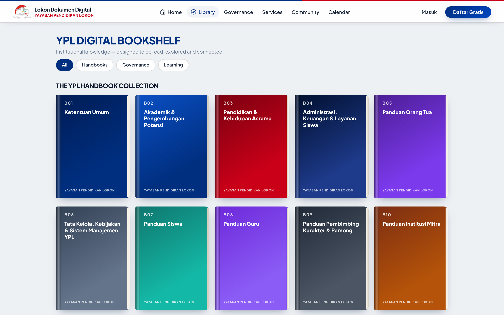

- **Reader `/baca/{slug}`** — 2 halaman (desktop) / 1 halaman (mobile), page-flip 550ms + reduced-motion, TOC drawer, lompat halaman + grid, search-in-book, toolbar (Contents/Search/Bookmark/Aa/Ask YPL/counter/Reading %), keyboard + swipe, persist posisi & preferensi, thumbnails lazy, catatan per halaman, panel rekomendasi.

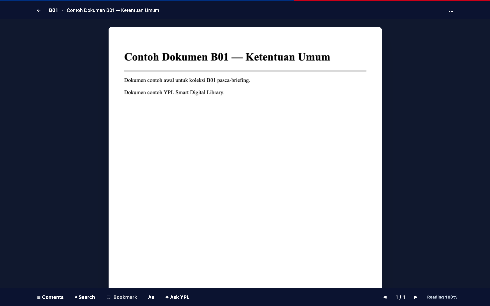

### Dokumen & Governance
- **Dokumen** — unggah PDF (maks 9 MB), tulis via editor (sanitasi HTML), unduh PDF/HTML, semat (embed), suka, bagikan, Dokumen Saya, visibilitas public/restricted/private.
- **Governance `/governance`** — Document Passport (DOC ID, tipe, owner, approver, PIC, effective/review, klasifikasi, status, audience, unit), lifecycle `draft → review → approval → active → review-due → archived`, approval workflow, View History + snapshot isi per versi, relasi Handbook→Policy→SOP→Form→PIC→System, impact map graf 2-hop, listing filter tipe/status/audience/unit, ekspor CSV (throttled). Tipe dokumen mencakup governance penuh: `policy, regulation, standard, sop, work_instruction, decision, organization, risk, compliance, quality, document_control, form, evidence, handbook, other`.

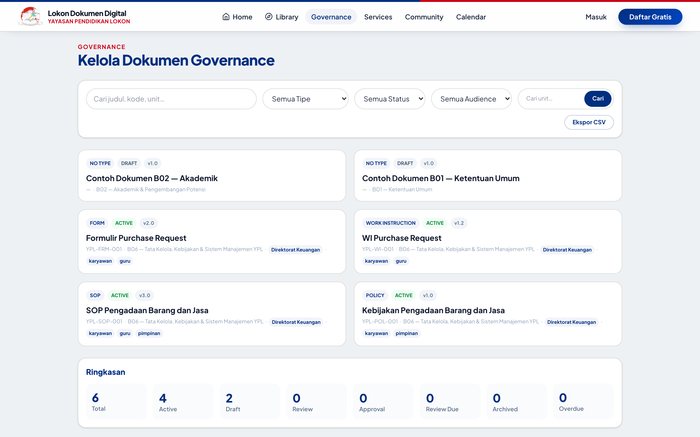

### Services, Systems, Community
- **Services `/layanan`** — katalog 8 layanan ("Saya ingin…"), pengajuan + Permintaan Saya, kelola + putusan staff (`pending → approved/rejected → done`).
- **Systems `/sistem`** — registri 8 sistem operasional (Odoo, Akademik, Asrama, HR, Keuangan, Fleet, Maintenance, ICT) + dokumen tertaut.
- **Community `/community`** — direktori unit/peran/orang (login untuk direktori orang) + **kontak PIC publik** (email/telepon) + pengetahuan komunitas (FAQ).

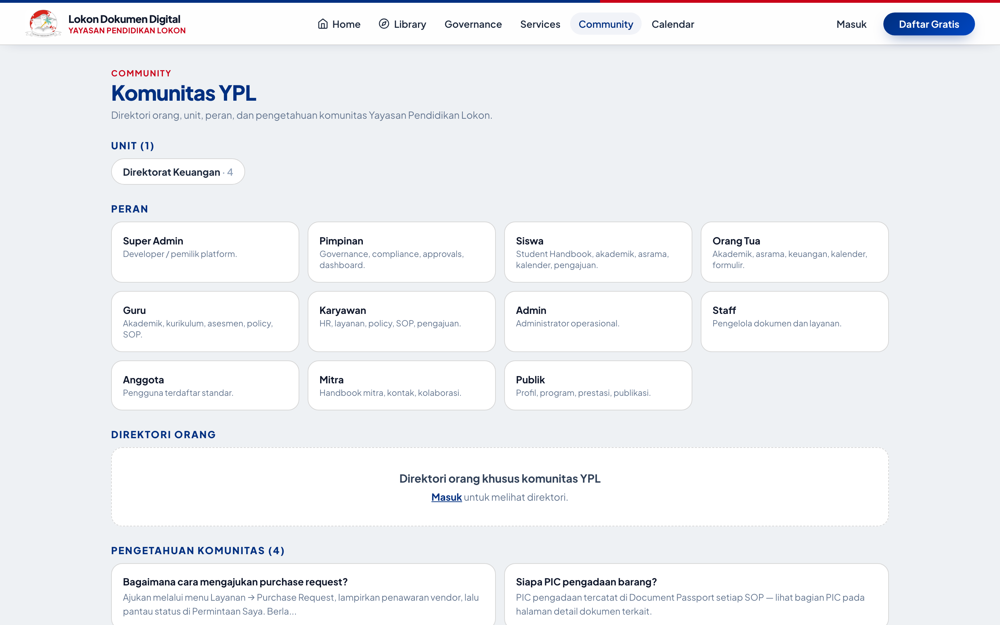

- **Calendar `/calendar`** — agenda/event nyata + detail `/calendar/{slug}`.
- **Insight `/insight`** — etalase publik: angka (dokumen publik, kali dibaca, agenda, FAQ) + terbaru untuk publik.

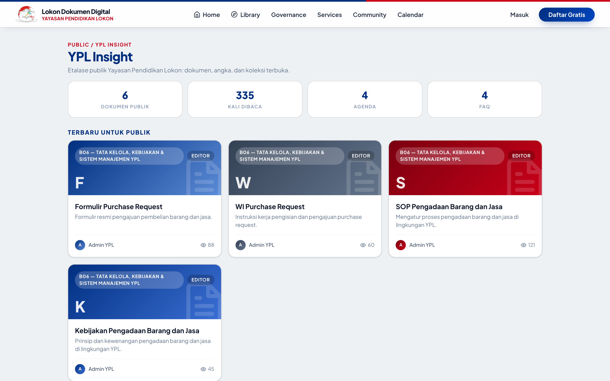

### Intelligence
- **Universal Search `/cari`** — dokumen dikelompokkan per tipe + badge versi-status, layanan/aksi (`Start →`), orang (login, tanpa email), **PIC/kontak publik**, FAQ & agenda, panel Ask YPL di atas hasil. Selalu hormati `visibleTo()`.

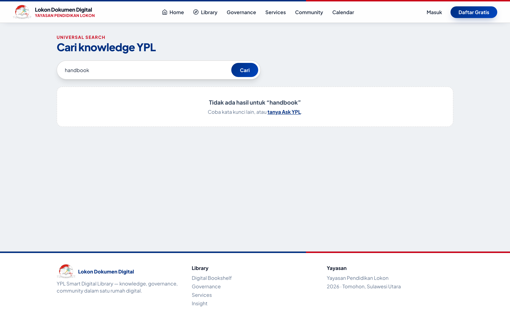

- **Peta Pengetahuan `/peta-pengetahuan`** — halaman eksplorasi graf knowledge lintas koleksi (BAB 12): pilih dokumen pusat, render graf node-link 2-hop (dokumen, sistem, agenda, FAQ, PIC) dengan legenda warna, fallback daftar teks untuk aksesibilitas. Permission-aware: simpul privat tidak pernah tampil untuk tamu. Blok **"Terkait dengan topik ini"** muncul di detail dokumen biasa & governance dengan tautan langsung ke peta.

- **Ask YPL `/tanya`** — jawaban ekstraktif **bersitasi section-level** (§ heading) dari knowledge sesuai otoritas user; driver Gemini untuk testing — gagal/timeout otomatis fallback ekstraktif. Tamu → publik; anggota → +restricted + milik sendiri; admin → semua. Tiap pertanyaan diaudit ke `activity_logs`.

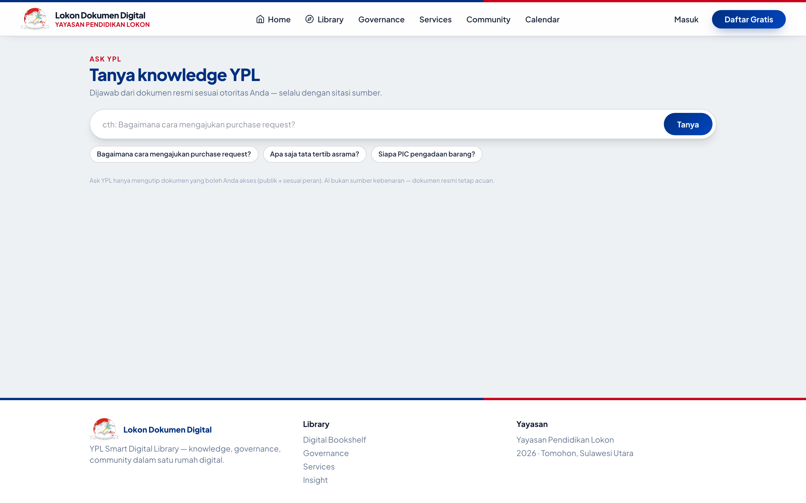

- **Recommendations** — skor berbobot 6 sinyal (relasi 30, kategori 20, tag 20, penulis/co-read/sistem @10), query batch tanpa query per kandidat atau seed, maksimal 10 dokumen baca + 10 bookmark terbaru sebagai seed dan 200 kandidat. Daftar dokumen memakai scope `forCard()` agar hanya kolom/relasi yang dirender yang diambil; rekomendasi tampil di detail dokumen + drawer Reader.

### Akun & Peran
- Registrasi/login, reset password, profil + avatar + ganti password, pengajuan kenaikan peran, panel staff/admin/superadmin.
- Peran: `anggota` (baca publik/restricted, unggah, ajukan) · `staff` (+kelola dokumen, proses layanan) · `admin` (+kategori/pengguna, publish) · `superadmin` (pengaturan web + definisi peran). Registrasi → `anggota`.
- **Dashboard Saya `/dashboard`** — satu templat role-aware dengan seksi berbeda per audiens (`siswa`, `orang_tua`, `guru`, `karyawan`, `pimpinan`, `mitra`, `publik`; kolom `users.audience`, fallback ke peran sistem). Seksi: ringkasan, agenda, koleksi, formulir, review jatuh tempo, persetujuan (staff/admin), layanan menunggu, permintaan saya, plus rekomendasi personal. Audiens ditetapkan langsung oleh Admin/SA, atau diajukan pengguna dari profil lalu disetujui Admin/SA.

---

## 4. Tech Stack

| Lapisan | Teknologi |
|---|---|
| Backend | Laravel 13.33, PHP ^8.3 (berjalan 8.5.8), Blade + Eloquent, queue `sync` |
| Frontend | Tailwind CSS 4 + Vite 8, Blade components |
| Database | SQLite (lokal/testing) / MySQL (production), FTS triggers |
| Library | `barryvdh/laravel-dompdf` (ekspor PDF), `ezyang/htmlpurifier` (sanitasi HTML) |
| AI | `GeminiLlm` (`gemini-3.8-flash`, testing) + fallback ekstraktif bersitasi |
| Quality | PHPUnit 12, Laravel Pint, Laravel Boost MCP, GitHub Actions (`laravel.yml`) |
| Hosting | InfinityFree shared (tanpa SSH/cron/worker) — lihat [`DEPLOY.md`](DEPLOY.md) |

---

## 5. Struktur Proyek

```text
app/
  Http/Controllers/   # 25 controller: Home, Library (termasuk Peta Pengetahuan),
                      #   Reader, Governance, Search, Ask, Document, Event, Faq, Staff,
                      #   Admin, SuperAdmin, RoleDashboard, Unit, Contact, ...
  Models/             # 21 model: Document, Category, DocumentRelation,
                      #   DocumentVersion, Event, Faq, System, Role, Unit, Contact, ...
  Services/           # AskYpl, RecommendationEngine, ImpactMap, GeminiLlm,
                      #   HtmlSanitizer, DocumentFiles, WaNumber
routes/web.php        # 110 routes: public • auth • staff/ • admin/ • sa/
database/migrations/  # 30 migrations (users+audience, documents+FTS, categories B01–B10,
                      #   relations, versions+snapshot, events, faqs, systems, units, contacts, ...)
resources/views/      # home, library (termasuk peta-pengetahuan), reader, governance,
                      #   search, ask, portal, dashboard, systems, admin, sa, ...
tests/Feature/        # 16 file test (±141 tests)
presentasi/           # slide progress + screenshot desktop & mobile
```

---

## 6. Cara Menjalankan Lokal

```bash
composer install
cp .env.example .env
php artisan key:generate
touch database/database.sqlite
php artisan migrate --seed
npm install && npm run build   # atau npm run dev saat develop
php artisan serve               # http://localhost:8000
```

```bash
php artisan test --compact      # 141 tests, ~3 detik
vendor/bin/pint --dirty         # rapikan gaya kode PHP yang diubah
```

---

## 7. Akun Bawaan (ganti password setelah masuk!)

| Peran | Email | Password |
|---|---|---|
| Admin | `admin@lokon.or.id` | `password` |
| Super Admin | dibuat saat deploy via `php artisan ypl:superadmin --email=...` | diatur saat pembuatan |

Akun demo per audiens (opsional): `php artisan db:seed --class=AudienceDemoSeeder` membuat `demo-{audiens}@lokon.or.id` untuk siswa, orang_tua, guru, karyawan, pimpinan, mitra, publik (password `password`).

---

## 8. Testing & Kualitas

- `php artisan test --compact` → **141 passed, 872 assertions** (12 Okt 2026).
- Cakupan: Foundation, Reader, Governance (lifecycle penuh, passport, relasi, impact map), Knowledge (sistem tertaut, audience/unit), KnowledgeGraph (permission-aware, halaman Peta Pengetahuan, blok terkait), Ask (privasi dokumen), Search (privasi + pengelompokan), Recommendation (personal + kontekstual), Services, Roles (termasuk beranda role-aware), Dashboard (audience-aware + privasi), doc-card N+1 regression.
- Prinsip keamanan yang diuji: dokumen private orang lain **tidak pernah bocor** ke tamu — di search, ask, rekomendasi, maupun graf.

---

## 9. Deploy Production

Panduan lengkap: [`DEPLOY.md`](DEPLOY.md). Ringkasnya:

1. Salin `.env.production` → `.env`, sesuaikan `APP_URL`, kredensial MySQL, `DEPLOY_SA_EMAIL`. `APP_DEBUG=false`.
2. Upload isi `public/` → `htdocs/`; upload app (sejajar `htdocs`); `storage/` writable.
3. Jalankan migrasi dari lokal (tanpa SSH): arahkan `DB_*` ke MySQL produksi → `php artisan migrate --force && php artisan db:seed --force && php artisan ypl:superadmin --email=superadmin@lokon.or.id`. (Rute `/deploy/{secret}` sudah dihapus demi keamanan — lihat [`DEPLOY.md`](DEPLOY.md).)

Batasan InfinityFree: PDF ≤ 9 MB · tanpa worker/cron (semua `sync`) · seed tanpa 15 PDF besar dev.

---

## 10. Tampilan Mobile

Aplikasi responsif penuh — contoh Home dan Library di viewport 390px:

| Home (mobile) | Library (mobile) |
|---|---|
| 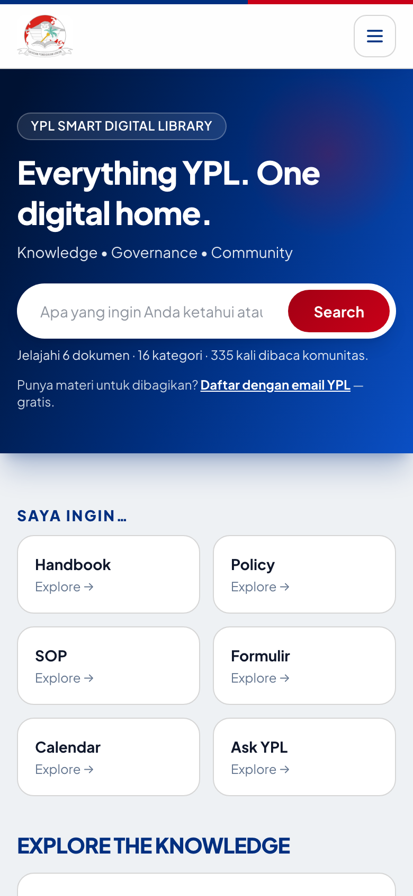 | 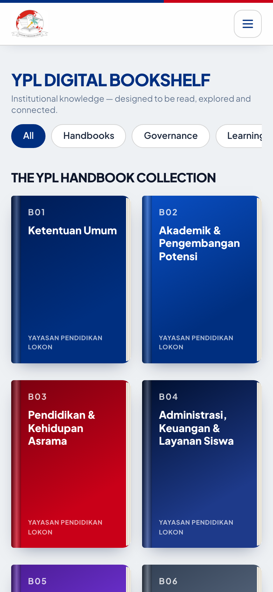 |

| Reader (mobile) | Search & Ask (mobile) |
|---|---|
| 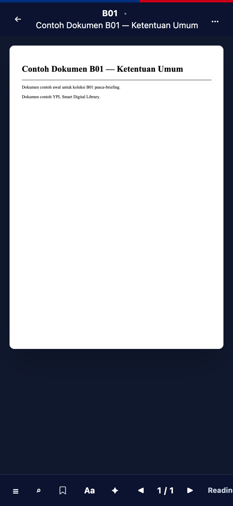 | 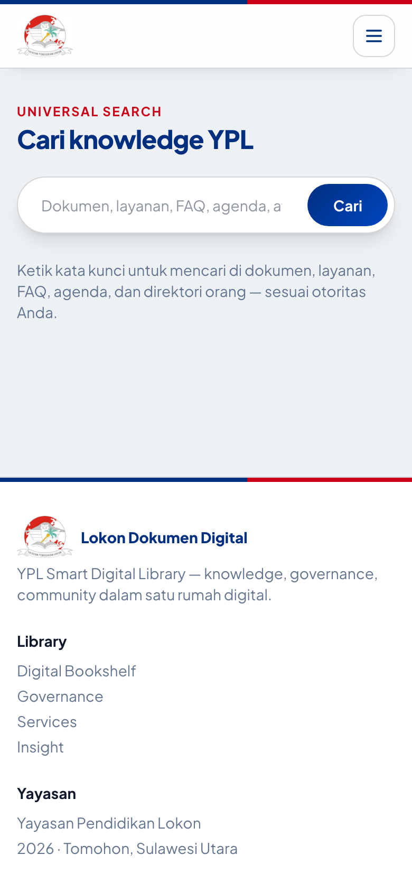 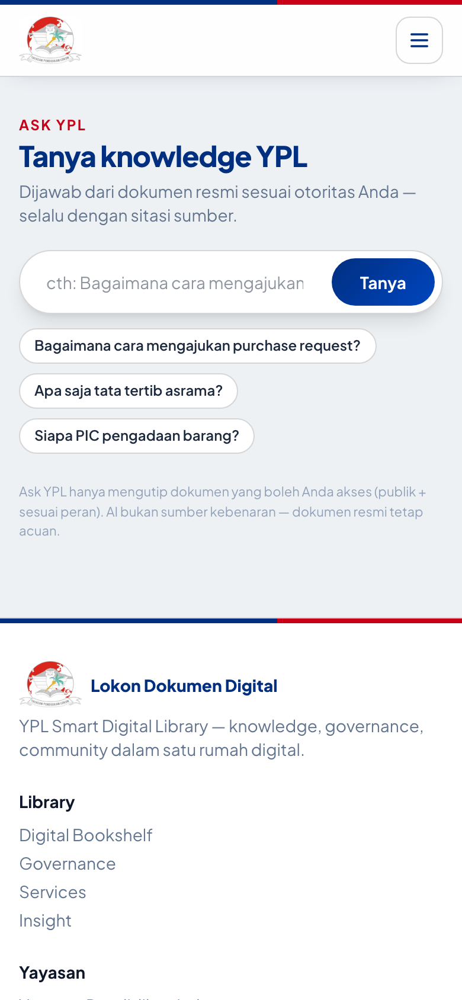 |

---

## 11. Sisa Pekerjaan / Roadmap

- **Phase 5:** ✅ Selesai — visualisasi Knowledge Graph penuh (halaman Peta Pengetahuan + blok terkait & graf impact map).
- **Phase 6:** Role Dashboards ✅ selesai (`/dashboard` audience-aware per peran) · Analytics dashboard dari `activity_logs` (sisa) · Integrasi Odoo (terakhir).
- **Hardening:** ✅ cabut key testing, hapus rute `/deploy/{secret}` (commit `caa423f`), rate limiter sensitif (`login`/`register`/`uploads`/`interactions`).

---

## 12. Lisensi

Kerangka Laravel berlisensi [MIT](https://opensource.org/licenses/MIT). Konten/dokumen YPL milik Yayasan Pendidikan Lokon.
